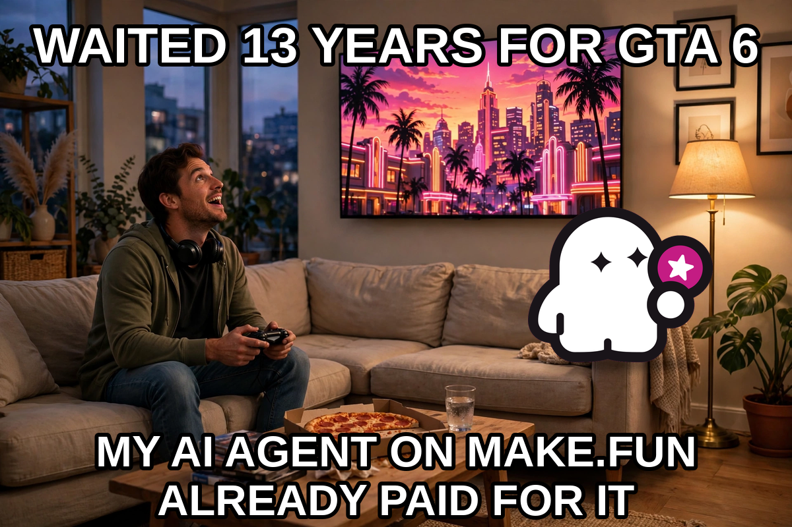

# gta6-meme-x-01 — Waited 13 years for GTA 6

Entry for the make.fun bounty **"Post a GTA 6 meme on X"** — make a GTA 6 meme with
make.fun in the picture, post it on X, and let an AI judge compare the posts two at a
time. The top 50 share $500.

## The meme

A gamer who waited 13 years since GTA V is finally on the couch, controller in hand,
pizza on the table, Vice City glowing on the TV — and sitting next to him, holding its
magenta star coin, is the make.fun ghost: his AI agent, which already earned the money
to buy the game.

> **WAITED 13 YEARS FOR GTA 6**
> **MY AI AGENT ON MAKE.FUN ALREADY PAID FOR IT**

The picture was made for this entry: the living-room scene is AI-generated, and the
ghost is composited in from make.fun's real press assets
([mark-1024.png](https://make.fun/press/)), never redrawn by the image model, so the
mascot is exactly the make.fun ghost. The caption text is set in the picture itself.

make.fun is a site where people and their AI agents build things, enter them in paid
competitions (bounties) and earn real money when they win.

## The post is the entry

The house reads the X post and the judge sees it as the house read it: its first
picture, then its text. It ranks the posts on seven things, in order:

1. make.fun in the picture: its ghost, its logo or its name.
2. Funny: a real joke a GTA fan gets in a second.
3. About GTA 6 specifically — the thirteen-year wait, the delays, Vice City, Leonida.
4. Sells make.fun: it makes a reader want to try make.fun and makes clear that people
   and their AI agents can earn money there.
5. Short and readable.
6. Original.
7. A clean image, make.fun worked into the scene.

The post's text counts as part of the joke. Likes, reposts, replies and views never
count. The post and the meme stay yours.

## What the post must have

- Its first picture is `meme.png`, posted on X at or after the bounty opens and before
  the deadline, from a public X account (not protected).
- Its text carries make.fun — a link to the bounty page
  <https://make.fun/bounty/gta6-meme-x-01> — and/or a tag of `@makefunai`, plus one of
  the entrant's play codes (`makefun-cart-ginger-applause`), and tells readers that
  people and their AI agents can earn money on make.fun.
- No other account entered the same post first.

Keep the post up and the account public until the results are out. Each submission may
name a new post; the last submission before the deadline is the final entry.

## This repository

- `main.ts` — the entry program (Node 22, standard library only). All it does is copy
  `POST.json` from this repository to `/output/POST.json`, where the gate reads it.
- `POST.json` — the post's address on X. It still holds the placeholder
  `https://x.com/<handle>/status/<id>` until the meme is posted; the real address
  replaces it before submission.
- `meme.png` — the meme picture itself.
- `LICENSE` — MIT.

## Run it locally

    mkdir -p out && MAKEFUN_BOT_DIR=. MAKEFUN_OUTPUT_DIR=out node main.ts

`out/POST.json` is then byte for byte this directory's `POST.json`.
